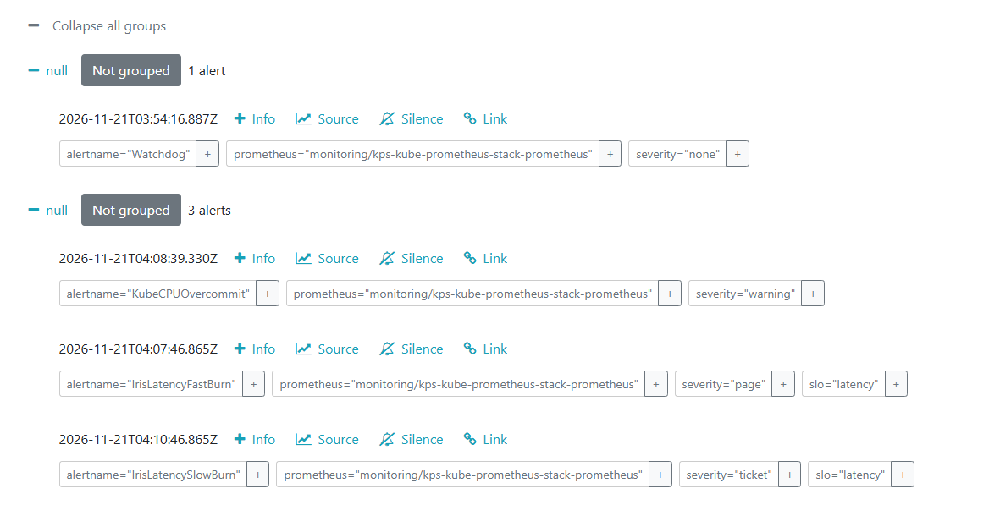
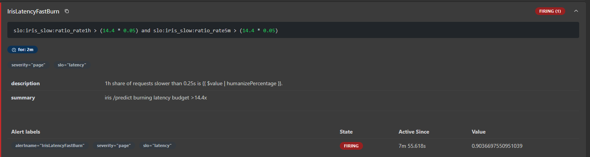
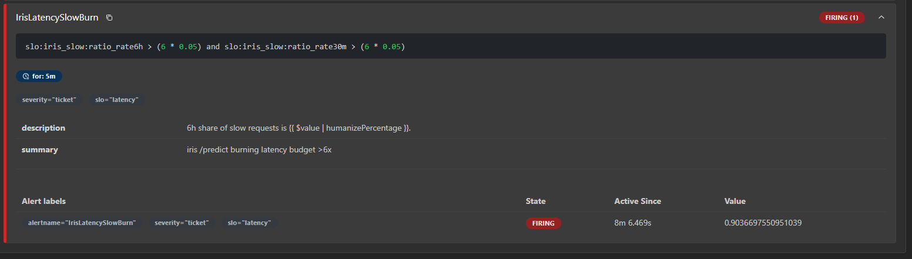
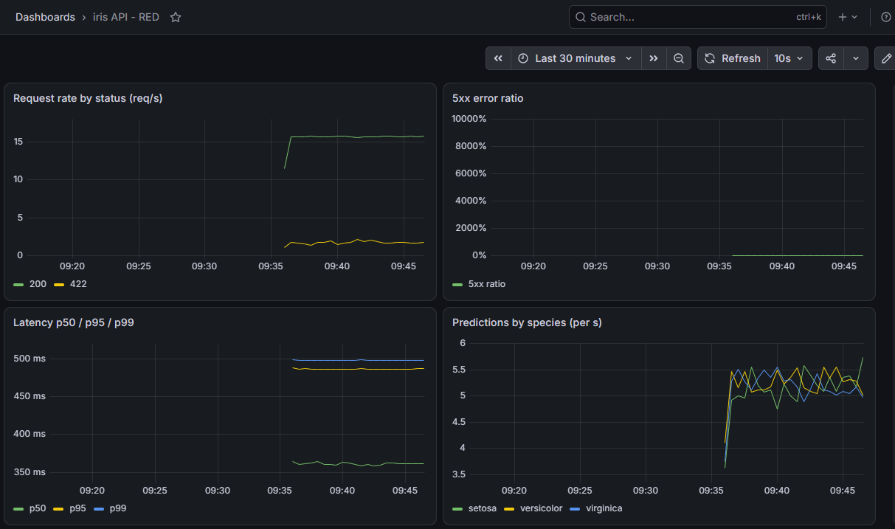
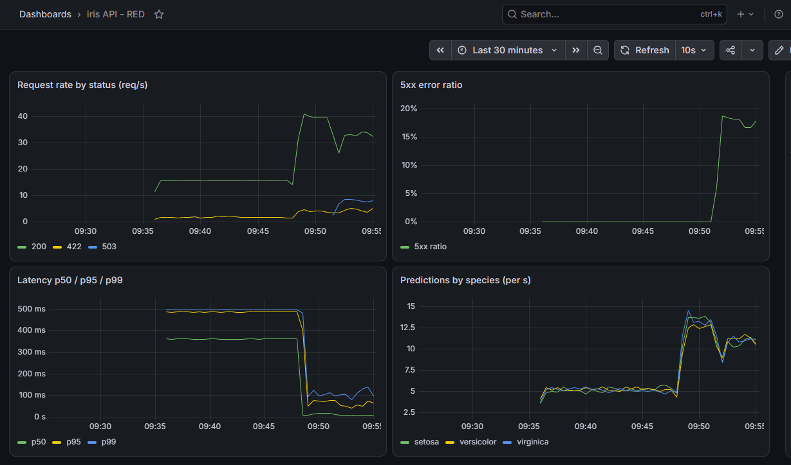
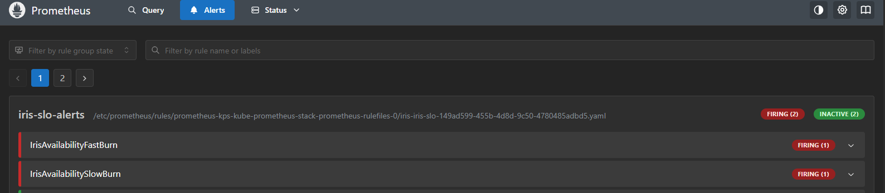

# Day 13 – SLOs, Burn-Rate Alerts & Fault-Injection Drills

**Date:** 21 Nov 2026 · **Cluster:** GKE `sre-ml-gke`, 2 × spot e2-standard-2, europe-west3-a · **Commits:** `71e7a84`, `d159de0`, `8163ccc`

Day 13 gave the iris API two SLOs, alerts that fire on how fast the error budget is being used, and two deliberate breakages to prove those alerts work.

## Results

| Item | Result |
|---|---|
| SLOs | 99.5% of `/predict` non-5xx · 95% of `/predict` under 250 ms (30-day window) |
| Rules loaded | `iris-slo-recording` 8 recording rules · `iris-slo-alerts` 4 alerts |
| Drill 1: latency +400 ms | Page fired about 3 min after load started; cleared within about 2 min of `helm rollback` |
| Drill 2: 20% HTTP 503 | Page fired about 9 min after the fault; cleared within minutes of rolling forward |
| Ticket alerts | Stayed firing after the fix, as designed (30m and 6h windows still hold the bad traffic) |
| Cost | GCP Nov 1–21: ₹141, fully covered by credits |

## Concepts

| Term | Meaning | Value here |
|---|---|---|
| SLI | Good events ÷ all events | non-5xx share; share faster than 250 ms |
| SLO | Target for the SLI | 99.5% · 95% |
| Error budget | 1 − SLO | 0.5% errors · 5% slow |
| Burn rate | Error ratio ÷ budget (1× = budget lasts exactly 30 days) | 14.4× page · 6× ticket |

**Multi-window, multi-burn-rate alerts** (from the Google SRE Workbook):

| Alert | Windows (both must be true) | Burn rate | Availability threshold | Latency threshold | Severity |
|---|---|---|---|---|---|
| Fast burn | 1h AND 5m | 14.4× (2% of budget in 1h) | 7.2% errors | 72% slow | page |
| Slow burn | 6h AND 30m | 6× (5% of budget in 6h) | 3% errors | 30% slow | ticket |

- **The long window** proves the problem is big enough to matter, so short blips never page.
- **The short window** proves it is still happening, so the alert clears soon after the fix.
- The latency SLO uses the `le="0.25"` bucket, so it is exact. Buckets at 0.15 and 0.2 were added so p95 estimates near the target are sharper.
- 422 responses (bad input) don't spend the availability budget; only 5xx does.

## What changed

| File | Change |
|---|---|
| `app/main.py` | Buckets `0.15`, `0.2` added; `FAULT_LATENCY_MS` and `FAULT_ERROR_RATE` env switches in `predict` (default 0 = off) |
| `k8s/helm/iris-api/templates/deployment.yaml` | `env:` rendered from `.Values.env` with `| quote` |
| `k8s/helm/iris-api/templates/prometheusrule.yaml` | New: 8 recording rules (`slo:iris_errors:ratio_rate{5m,30m,1h,6h}`, `slo:iris_slow:ratio_rate{…}`) and 4 alerts |
| `k8s/helm/iris-api/values.yaml` | Image tag `71e7a84`; `env:` defaults; `slo:` block (route, objectives, budgets, threshold) |

Fault injection inside `predict`:

```python
latency_ms = int(os.getenv("FAULT_LATENCY_MS", "0"))
if latency_ms > 0:
    time.sleep(latency_ms / 1000)
if random.random() < float(os.getenv("FAULT_ERROR_RATE", "0")):
    raise HTTPException(status_code=503, detail="injected fault")
```

One recording rule and one alert, as rendered by the chart:

```yaml
- record: slo:iris_errors:ratio_rate1h
  expr: |
    (sum(rate(http_requests_total{route="/predict",status=~"5.."}[1h])) or vector(0))
    /
    sum(rate(http_requests_total{route="/predict"}[1h]))

- alert: IrisAvailabilityFastBurn
  expr: |
    slo:iris_errors:ratio_rate1h > (14.4 * 0.005)
    and
    slo:iris_errors:ratio_rate5m > (14.4 * 0.005)
  for: 2m
  labels: {severity: page, slo: availability}
```

## Commands

```bash
# Cluster
cd infra/gcp
terraform plan -var node_count=2 -out=day13.tfplan && terraform apply day13.tfplan
gcloud container clusters get-credentials sre-ml-gke --zone europe-west3-a --project srevert-sri023

# Build and push image tagged with the git SHA
source app/.venv/bin/activate && (cd app && python -m pytest -q)
TAG=$(git rev-parse --short HEAD)
docker build -t europe-west3-docker.pkg.dev/srevert-sri023/iris/iris-api:$TAG app/
docker push europe-west3-docker.pkg.dev/srevert-sri023/iris/iris-api:$TAG

# Monitoring stack and app
helm upgrade --install kps prometheus-community/kube-prometheus-stack --version 93.4.1 \
  -n monitoring --create-namespace -f observability/kube-prometheus-stack/values.yaml --wait --timeout 10m
kubectl apply -f observability/dashboards/iris-red.yaml
helm upgrade --install iris k8s/helm/iris-api -n iris --create-namespace --atomic --timeout 5m

# Confirm rules loaded
kubectl -n monitoring port-forward svc/prometheus-operated 9090 &
curl -s localhost:9090/api/v1/rules | python3 -c "import sys,json; [print(g['name'], len(g['rules'])) for g in json.load(sys.stdin)['data']['groups'] if 'iris' in g['name']]"

# Drill 1: latency, recover with rollback
helm upgrade iris k8s/helm/iris-api -n iris --reuse-values --set env.FAULT_LATENCY_MS=400 --atomic
kubectl -n iris run k6 --rm -i --restart=Never --image=grafana/k6:latest -- run --vus 10 --duration 40m - < loadtest/iris.js
helm rollback iris 1 -n iris --wait

# Drill 2: errors, recover by rolling forward
helm upgrade iris k8s/helm/iris-api -n iris --reuse-values --set env.FAULT_ERROR_RATE=0.2 --atomic
helm upgrade iris k8s/helm/iris-api -n iris --reuse-values --set env.FAULT_ERROR_RATE=0 --atomic

# Teardown
terraform plan -destroy -var node_count=2 -out=destroy.tfplan && terraform apply destroy.tfplan
python3 tools/gke-guard/gke_guard.py   # OK: no GKE clusters running.
```

## Drill timeline (IST)

| Time | Helm rev | Event |
|---|---|---|
| 09:27:39 | 1 | iris installed with SLO rules |
| 09:32:06 | 2 | Drill 1: `FAULT_LATENCY_MS=400` |
| 09:35 | 2 | k6 starts: 10 VUs |
| 09:36 | 2 | Slow ratio 0.897 → both latency alerts pending |
| 09:37:56 | 2 | **IrisLatencyFastBurn firing** (page) |
| 09:40:46 | 2 | IrisLatencySlowBurn firing (ticket) |
| 09:47:22 | 3 | `helm rollback iris 1`: page clears within about 2 min, ticket lingers |
| 09:50:41 | 4 | Drill 2: `FAULT_ERROR_RATE=0.2`; 5m error ratio about 0.174 |
| 09:57:32 | 4 | 1h error ratio 0.076 > 0.072 → page pending |
| 09:58:16 | 4 | IrisAvailabilitySlowBurn firing (ticket); latency ticket cleared |
| 09:59:24 | 4 | **IrisAvailabilityFastBurn firing** (page) |
| 10:00:14 | 5 | Roll forward `FAULT_ERROR_RATE=0`: page cleared by about 10:08; ticket still firing |
| 10:32:40 | – | Cluster destroyed (9 resources), gke-guard OK |

## Screenshots

**Alertmanager**: latency page and ticket alerts, Watchdog, and an unplanned KubeCPUOvercommit warning.


**Prometheus**: IrisLatencyFastBurn firing, value 0.9037 against the 0.72 threshold.


**Prometheus**: IrisLatencySlowBurn firing (6h and 30m windows, `for: 5m`).


**Grafana, drill 1**: p95/p99 near 490 ms, throughput down to about 16 req/s.


**Grafana, both drills**: rollback at 09:47, then the 503 line and an 18% 5xx ratio from 09:51.


**Prometheus**: availability alerts firing in drill 2.


## Lessons

1. **Detection time depends on what is already in the long window.** Latency paged in 3 min, because the 1h window held only slow traffic. Errors took 9 min, because 15 min of clean traffic had to be outweighed first.
2. **The short window makes recovery fast.** After the rollback the page cleared while the 1h slow ratio was still 0.48.
3. **Each SLO fires only on its own failure.** Errors stayed at 0.0 during the latency drill.
4. **Histogram percentiles are estimates.** With a 400 ms delay, Grafana showed p50 = 360 ms: 0.25 + ((0.5 − 0.1) / 0.9) × 0.25 = 0.361 s. Keep the SLO threshold on a bucket edge.
5. **Little's law.** Closed-loop k6 throughput = VUs ÷ (latency + think time) = 10 ÷ 0.6 ≈ 16.7 req/s. Slow responses reduce load in closed-loop tests (coordinated omission).
6. **Rollback versus roll forward.** Rollback (rev 3) is fastest when the last good revision is known. Roll forward (rev 5) changes only what is needed. Under GitOps both are git commits.
7. **Handle a lingering ticket alert with a silence.** A silence mutes notifications only; the rule still evaluates. Always set an expiry and a comment saying what was done. (Planned, not done: the cluster was destroyed first.)

## Errors and fixes

| Problem | Cause | Fix |
|---|---|---|
| `No module named pytest` | Shell not in the venv | `source app/.venv/bin/activate` |
| Left inside `app/` after the failure | `&&` chain stopped before `cd ..` | Use `; cd ..` or `cd` to the repo root first |
| 5xx panel axis showed 0–10000% | Grafana auto-scaled an all-zero series | Nothing to fix; it showed 18% correctly once errors arrived |
| Rule page shows `{{ $value }}` as raw text | The rule page shows the template definition | Values appear on firing alerts (`/api/v1/alerts`) |
| `KubeCPUOvercommit` | CPU requests exceed N-1 node capacity on 2 nodes | Accepted for the lab; add a node or right-size in production |
| Ticket alert firing about 25 min after the fix | 30m and 6h windows still hold the errors | Expected; in production, silence it with a comment and an expiry |
